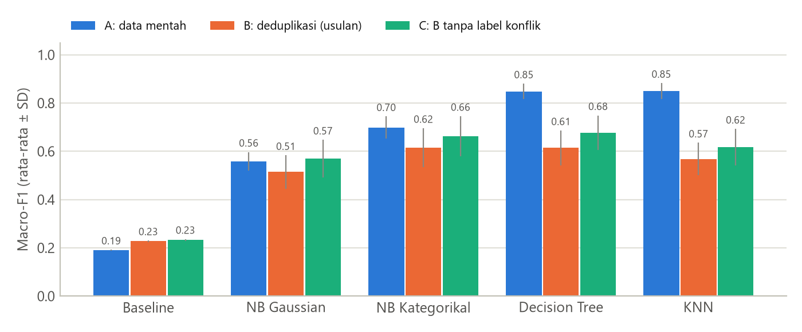

# Klasifikasi Tingkat Risiko Kesehatan Ibu Hamil

**Perbandingan Algoritma Naive Bayes, Decision Tree, dan K-Nearest Neighbor untuk Klasifikasi Tingkat Risiko Kesehatan Ibu Hamil dengan Penanganan Data Duplikat**

Proposal UTS dan aplikasi (luaran UAS) mata kuliah Penambangan Data, Teknik Informatika S1, Universitas Dian Nuswantoro.

**Aplikasi online:** https://risiko-ibu-hamil-fafa.streamlit.app

| | |
|---|---|
| Nama | Fahmi Fatmawati Azzahra |
| NIM | A11.2024.15831 |
| Kelas | Penambangan Data / A11.4505 |
| Dosen pengampu | Junta Zeniarja, M.Kom |

## Inti penelitian

Dataset publik *Maternal Health Risk* (UCI) sering dipakai dengan akurasi yang dilaporkan 61–97%. Pemeriksaan data menemukan
**562 dari 1.014 baris (55,4%) adalah duplikat persis**. Jika data dibagi tanpa deduplikasi, rata-rata **83,4% baris di
setiap fold uji punya salinan identik di data latih**, sehingga model cukup "menghafal" (kebocoran data).

Penelitian ini membandingkan NB, DT, dan KNN dengan cara evaluasi yang bebas kebocoran: deduplikasi, validasi berbasis grup,
dan *nested cross-validation* 10×10.

## Hasil eksperimen (konfigurasi hasil tuning, rata-rata 100 fold uji)

| Algoritma | Macro-F1 A (data mentah) | Macro-F1 B (usulan) | Inflasi A − B | Recall Risiko Tinggi B |
|---|---|---|---|---|
| Baseline (kelas mayoritas) | 0,191 | 0,227 | −0,037 | 0,000 |
| Naive Bayes Gaussian | 0,559 | 0,514 | +0,044 | 0,527 |
| Naive Bayes Kategorikal | 0,699 | 0,615 | +0,084 | 0,702 |
| **Decision Tree (CART)** | 0,848 | **0,614** | +0,234 | **0,739** |
| K-Nearest Neighbor | 0,850 | 0,569 | +0,281 | 0,658 |

- Pada data mentah, akurasi DT dan KNN sekitar 84–85%, mirip angka di jurnal. Setelah kebocoran dihilangkan, akurasinya
  turun ke 67–69%.
- Kebocoran mendorong tuning memilih model yang menghafal: di skenario A, KNN memilih k = 1 pada 60% fold (median
  k = 11 di skenario B), dan DT selalu memilih kedalaman tanpa batas sehingga pohonnya rata-rata 331 simpul
  (66 simpul di skenario B).
- Di skenario B, NB Kategorikal, DT, dan KNN tidak berbeda signifikan pada macro-F1 (uji t terkoreksi + Holm). Sesuai
  aturan pemilihan di proposal, **Decision Tree** dipilih karena recall Risiko Tinggi-nya paling tinggi dan aturannya
  mudah dijelaskan.
- Kelas tersulit adalah Risiko Sedang: sebagian besar salah diprediksi sebagai Risiko Rendah.

Detail lengkap ada di `reports/results/` dan halaman **Evaluasi Model** pada aplikasi.



## Isi repositori

```
├── data/raw/maternal_health_risk.csv   dataset asli dari UCI (CC BY 4.0)
├── src/
│   ├── config.py         path, nama atribut, rentang nilai wajar
│   ├── data.py           pemuatan data, skenario A/B/C, profil kualitas data
│   ├── models.py         pipeline NB, DT, KNN + ruang hyperparameter
│   ├── eda.py            EDA dan grafik
│   ├── experiment.py     nested CV 10×10, uji statistik, grafik hasil
│   ├── train_final.py    melatih model final untuk aplikasi
│   └── viz.py            gaya grafik
├── app/
│   ├── streamlit_app.py  aplikasi utama (navigasi)
│   ├── common.py         pemuatan model/data, penjelasan prediksi
│   └── views/            halaman Prediksi, Eksplorasi, Evaluasi, Tentang
├── models/               model .joblib, metadata, aturan Decision Tree
├── reports/
│   ├── figures/          semua grafik
│   └── results/          hasil eksperimen (CSV/JSON), log, hasil uji aplikasi
├── tests/uji_aplikasi.py pengujian black-box aplikasi (11 kasus uji)
└── proposal/
    └── Proposal UTS - A11.2024.15831 - ... .docx / .pdf   (10 halaman)
```

## Cara menjalankan

Membutuhkan Python 3.12 atau lebih baru.

```bash
python -m venv .venv
.venv\Scripts\activate
pip install -r requirements.txt
```

(Di Linux/Mac, aktifkan dengan `source .venv/bin/activate`.)

Menjalankan aplikasi:

```bash
streamlit run app/streamlit_app.py
```

Mengulang seluruh analisis dari awal (urutannya penting):

```bash
python -m src.eda
python -m src.experiment
python -m src.train_final
python tests/uji_aplikasi.py
```

`src.experiment` menjalankan 2.700 evaluasi model dan memakan waktu sekitar 20 menit di laptop 12 thread. Untuk
menggambar ulang grafik saja, pakai `python -m src.experiment --plots-only`.

## Deploy ke Streamlit Community Cloud

1. Push repositori ini ke GitHub.
2. Buka https://share.streamlit.io, masuk dengan akun GitHub, lalu pilih **Create app**.
3. Pilih repositori dan branch `main`, isi *Main file path* dengan `app/streamlit_app.py`.
4. Di **Advanced settings**, pilih Python 3.12 atau yang lebih baru (aplikasi ini berjalan di 3.14), lalu klik **Deploy**.

Jika model `.joblib` gagal dimuat di server karena perbedaan versi library, aplikasi otomatis melatih ulang model dari
data memakai hyperparameter yang tersimpan di `models/metadata.json`.

## Proposal

File proposal ada di folder `proposal/` dalam format Word (dapat diedit) dan PDF.

## Catatan

Aplikasi ini adalah alat bantu skrining edukatif dan **bukan** pengganti pemeriksaan bidan atau dokter. Data berasal
dari pedesaan Bangladesh sehingga model belum divalidasi untuk populasi Indonesia.

Sumber data: Ahmed, M. (2020). *Maternal Health Risk* [Dataset]. UCI Machine Learning Repository.
https://doi.org/10.24432/C5DP5D
